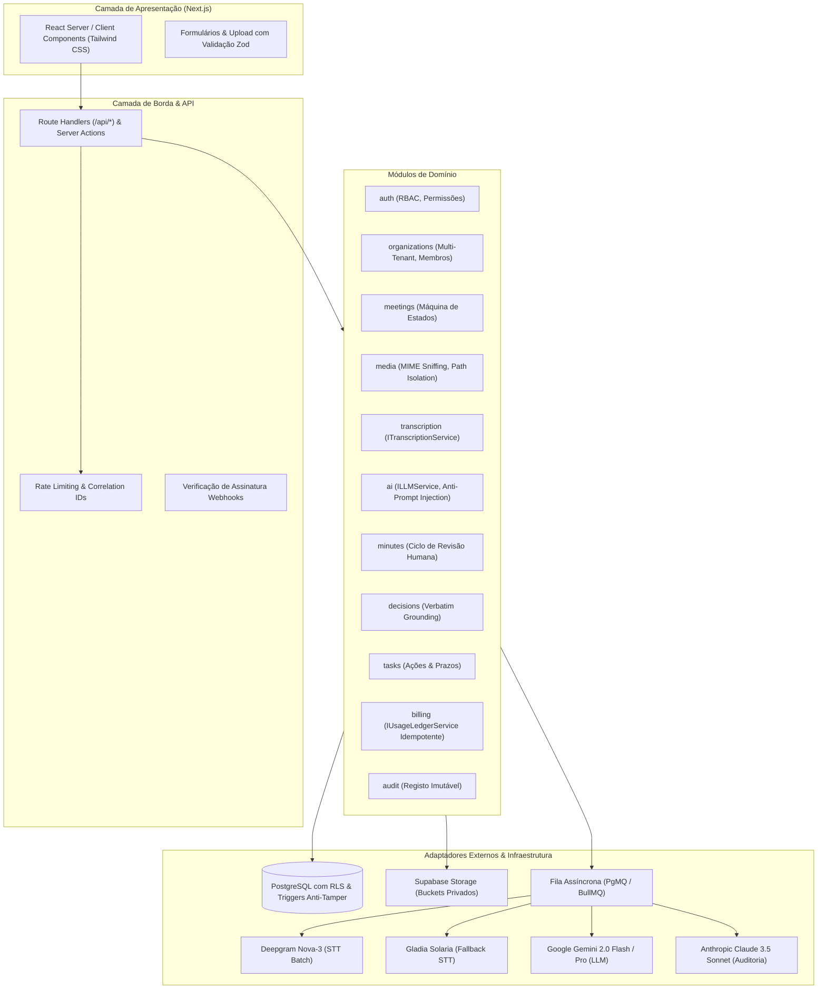

# Arquitetura Técnica do MEETWISE AI

## 1. Visão Geral da Arquitetura

O MEETWISE AI foi desenhado seguindo os princípios de isolamento estrito (*clean architecture* e *modular domain-driven design*), separando regras de domínio dos provedores externos de IA, banco de dados e frameworks de apresentação.

---

## 2. Camada de Abstração de Serviços

Para impedir o acoplamento a provedores proprietários de IA e armazenamento, o sistema utiliza contratos formais em TypeScript:

### 2.1 Transcrição (`ITranscriptionService`)
Permite alternar entre Deepgram Nova-3, Gladia Solaria ou qualquer motor compatível sem modificar a lógica das reuniões.
- Retorna segmentos normalizados (`NormalizedTranscriptSegment[]`) com timestamps por palavra e identificação de oradores (`Speaker 0`, `Speaker 1`).
- Suporta enriquecimento acústico via *keywords boosting* para terminologia jurídica e regional (Portugal, Angola, Brasil).

### 2.2 Modelos de Linguagem (`ILLMService`)
- Implementa extração com esquemas tipados rígidos (*Structured Outputs*).
- Encapsula obrigatoriamente a transcrição em tags delimitadoras `<untrusted_meeting_transcript>`.
- Injeta as diretrizes imutáveis de sistema proibindo a execução de ordens presentes na fala dos participantes.

### 2.3 Armazenamento (`IStorageService`)
- Gera URLs assinadas temporárias (*presigned URLs*) com validade máxima de 15 minutos.
- Garante que caminhos de arquivo sigam a convenção isolada `{organization_id}/{meeting_id}/{asset_id}.{ext}`.

### 2.4 Livro de Quotas (`IUsageLedgerService`)
- Operação em duas fases: Reserva prévia (`status = 'reserved'`) e Liquidação real (`status = 'settled'`) baseada nos segundos reais de áudio.
- Reversão imediata em caso de falha técnica (`status = 'cancelled'`) sem débito do cliente.
- Chaves de idempotência únicas por reunião e tentativa para prevenir contabilidade duplicada.
