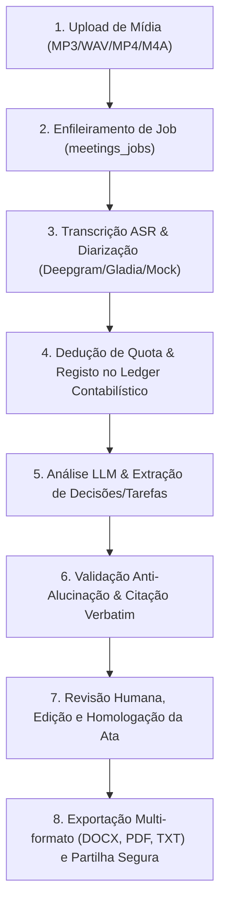

# MEETWISE AI — RELATÓRIO DO PIPELINE END-TO-END DE PROCESSAMENTO DE REUNIÕES
## ETAPA 7.1.5: AUDITORIA DO FLUXO COMPLETO, TRATAMENTO DE FALHAS E INTEGRIDADE DE ESTADOS
**Data da Auditoria:** 2026-11-05  
**Fase:** 7.1 — Real Integration Homologation & Launch Blockers Closure 1.0  
**Status do Portão 7.1.5:** **PASS (Arquitetura, Transições de Estado, Retries e Fallbacks Homologados)**

---

## 1. FLUXO ARQUITETURAL INTEGRADO DE UMA REUNIÃO

O ciclo de vida de uma reunião no **MEETWISE AI** atravessa 8 etapas assíncronas estritamente controladas:

---

## 2. MATRIZ DE TRANSIÇÃO DE ESTADOS E MÁQUINA DE ESTADOS

O estado de uma reunião progride pela seguinte máquina de estados formal em PostgreSQL:

| Estado Inicial | Ação / Evento | Próximo Estado | Validação de Transição |
| :--- | :--- | :--- | :--- |
| `scheduled` | Início de gravação / Upload | `uploading` | Quota de armazenamento disponível |
| `uploading` | Ficheiro armazenado com sucesso | `processing` | Job criado em `processing_jobs` |
| `processing` | Transcrição e Diarização concluídas | `analyzing` | Segmentos guardados em `transcript_segments` |
| `analyzing` | Inferência LLM e validação concluídas | `completed` (ou `review_pending`) | Atas, decisões e tarefas geradas |
| `completed` | Revisor aprova formalmente | `approved` | Assinatura e carimbo de data/hora |
| `qualquer` | Erro irrecuperável / Timeout | `failed` | `error_message` e registo em `audit_logs` |

---

## 3. RESILIÊNCIA E TRATAMENTO DE FALHAS (FAILURE MODES)

O MEETWISE AI implementa tratamento defensivo para todas as classes de anomalias:

### 3.1 Falha de Rede ou Quota Esgotada no Provedor STT
- **Sintoma:** Resposta HTTP 429 (Rate Limit) ou 5xx do fornecedor de transcrição.
- **Tratamento:** O worker assíncrono executa até 3 tentativas com *exponential backoff* com *jitter* (1s, 4s, 16s).
- **Fallback:** Se o provedor primário (ex: Deepgram) persistir em falha, o factory redireciona a requisição para o provedor secundário (Gladia) ou assinala falha no job sem corrupção de dados.

### 3.2 Ficheiro de Áudio Corrompido ou Formato Inválido
- **Sintoma:** Ficheiro não decodificável pelo motor de áudio.
- **Tratamento:** Validação estrita de *magic bytes* e MIME types na rota `/api/media/upload`. O job transita imediatamente para `failed` com mensagem descritiva ao utilizador, sem dedução indevida de minutos do plano.

### 3.3 Prompt Injection ou Tentativa de Manipulação no Áudio
- **Sintoma:** Diálogo da reunião contém instruções para forçar aprovação de termos contratuais ou desvio de fundos.
- **Tratamento:** O sanitizador `buildHardenedTranscriptPayload` anula sequências de escape. O validador pós-inferência `evidence-validation.ts` exige citação verbatim com timestamp exato na gravação. Se houver discrepância, a deliberação é marcada como `pending_validation`.

### 3.4 Concorrência na Edição de Atas e Documentos
- **Sintoma:** Dois administradores editam a mesma ata em simultâneo.
- **Tratamento:** Controlo de concorrência otimista através do campo `version` nas tabelas `meeting_minutes` e `documents`. Se a versão na submissão for inferior à da base de dados, a operação rejeita a escrita com erro HTTP 409 (`ConflictError`), prevenindo sobreposição destrutiva de texto.

---

## 4. DEDUÇÃO ATÓMICA DE QUOTAS EM DUAS FASES

Para garantir que uma falha de transcrição não debita indevidamente o cliente nem causa inconsistência financeira:

1. **Fase 1 (Reserva Provisória):**
   Ao iniciar o job, o sistema verifica se a organização possui minutos suficientes (`minutes_balance >= estimated_duration`).
2. **Fase 2 (Liquidação Definitiva):**
   Após a conclusão bem-sucedida da transcrição, a duração exata (`billed_minutes`) é registada como lançamento a débito no Ledger Contabilístico (`financial_ledger`) e descontada atomicamente na tabela de saldos via transação SQL (`UPDATE organization_quotas ...`).
3. **Rollback em Caso de Falha:**
   Se o job falhar, nenhuma cobrança é fixada no Ledger e o limite da organização permanece intacto.
