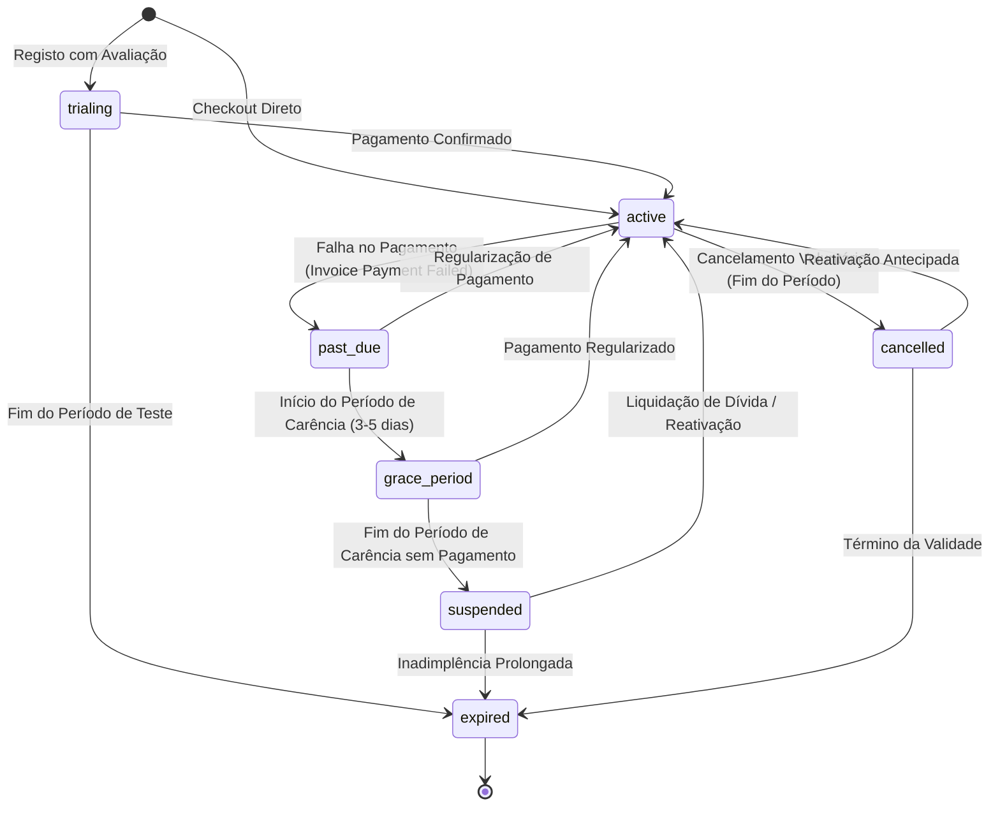

# Ciclo de Vida e Máquina de Estados de Subscrições (Fase 6)

## 1. Visão Geral

O ciclo de vida das subscrições no **MEETWISE AI** é gerido por uma máquina de estados determinística implementada em `SubscriptionService` (`src/modules/billing/subscription-service.ts`). O modelo previne saltos de estado inválidos, gerencia períodos de carência (*grace periods*) e garante a descontinuação ou reativação correta de quotas.

---

## 2. Diagrama de Estados

---

## 3. Matriz de Transições Permitidas

| Estado de Origem | Estados de Destino Permitidos | Ação Operacional / Evento Desencadeador |
| :--- | :--- | :--- |
| `trialing` | `active`, `cancelled`, `expired` | Início de subscrição paga, cancelamento ou expiração do teste. |
| `active` | `past_due`, `cancelled`, `suspended`, `grace_period` | Webhook de falha de cobrança, cancelamento pelo utilizador ou ação administrativa. |
| `past_due` | `active`, `grace_period`, `suspended`, `cancelled` | Re-tentativa com sucesso, ativação de carência ou suspensão do serviço. |
| `grace_period` | `active`, `suspended`, `cancelled` | Regularização do cartão/saldo ou término do prazo sem liquidação. |
| `suspended` | `active`, `cancelled`, `expired` | Pagamento efetuado via fatura em aberto ou encerramento definitivo. |
| `cancelled` | `active`, `expired` | Reativação antes do término da anuidade/mensalidade ou encerramento natural. |
| `expired` | `active` (via novo checkout) | Reabertura através de novo processo de subscrição e pagamento. |

---

## 4. Regras de Transição e Prorrogação

1. **Período de Carência (*Grace Period*):**
   - Ao receber uma notificação de falha de cobrança (`invoice.payment_failed`), o sistema coloca a subscrição em `past_due` ou `grace_period` durante 5 dias consecutivos.
   - Durante o `grace_period`, os utilizadores continuam com acesso de leitura e pesquisa às reuniões, atas e exportações existentes, mas a reserva de novos minutos de transcrição pode ser bloqueada caso o saldo mensal de minutos já tenha sido consumido.

2. **Cancelamento no Fim do Ciclo (*Cancel at Period End*):**
   - Quando o utilizador solicita o cancelamento, a subscrição passa para `cancelled`, mas mantém `cancel_at_period_end = true`.
   - O acesso às quotas do plano é mantido integralmente até `current_period_end`.
   - Caso o utilizador decida reativar antes dessa data, o sistema remove a flag de cancelamento e restabelece o estado `active`.

3. **Atualização (*Upgrade*) e Despromoção (*Downgrade*):**
   - No caso de *upgrade* imediato, a quota do novo plano é disponibilizada imediatamente.
   - O cálculo de rateio (*proration*) computa o valor restante do período corrente e deduz da nova fatura.
   - Nos casos de *downgrade*, a nova quota e preço entram em vigor no início do próximo ciclo de faturação.

4. **Tratamento de Inadimplência (*Suspended* / *Expired*):**
   - Quando a subscrição passa para `suspended` ou `expired`, o plano ativo da organização é imediatamente revertido para o plano `free`.
   - As reservas ativas de quotas pendentes são libertadas no PostgreSQL.
