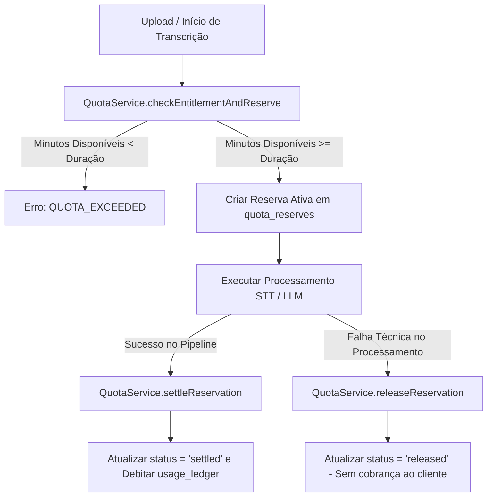

# Gestão de Quotas, Limites e Entitlements (Fase 6)

## 1. Visão Geral do Subsistema

O motor de quotas e direitos de utilização (*entitlements*) do **MEETWISE AI** é implementado em `QuotaService` (`src/modules/billing/quota-service.ts`). O seu propósito é garantir que nenhum processamento dispendioso de inteligência artificial (transcrição, diarização, síntese e extração de tarefas) seja executado sem prévia verificação e reserva atómica de saldo da organização contratante.

---

## 2. Quotas Globais por Plano

Cada plano de subscrição define um teto mensal de minutos de processamento de áudio:

| Plano | Minutos Incluídos / Mês | Membros Máximos | Retenção / Armazenamento | Política de Excesso |
| :--- | :--- | :--- | :--- | :--- |
| **Free** | 45 min | 1 utilizador | 500 MB / 30 dias | Bloqueio estrito (requer upgrade) |
| **Starter** | 180 min | 3 utilizadores | 5 GB / 180 dias | Bloqueio estrito (requer upgrade) |
| **Pro** | 600 min | 10 utilizadores | 25 GB / 365 dias | Upgrade de escalão ou compra de pacote |
| **Business** | 2.500 min | 50 utilizadores | 100 GB / Sem expiração | Pacotes adicionais de minutos |
| **Enterprise** | 10.000+ min | Ilimitado | Dedicado / SLA | Faturação pós-paga por minuto excedente |

---

## 3. Padrão de Reserva Atómica em Duas Fases (Two-Phase Settlement)

Para evitar condições de corrida (*race conditions*) em que múltiplos utilizadores da mesma organização iniciam o envio de ficheiros simultaneamente e excedem a quota contratada, o sistema utiliza uma tabela dedicada de reservas atómicas no PostgreSQL:

```sql
CREATE TABLE public.organization_quota_reserves (
    id UUID PRIMARY KEY DEFAULT gen_random_uuid(),
    organization_id UUID NOT NULL REFERENCES public.organizations(id) ON DELETE CASCADE,
    meeting_id UUID REFERENCES public.meetings(id) ON DELETE SET NULL,
    reserved_minutes INTEGER NOT NULL CHECK (reserved_minutes > 0),
    status VARCHAR(20) NOT NULL DEFAULT 'active' CHECK (status IN ('active', 'settled', 'released')),
    expires_at TIMESTAMPTZ NOT NULL DEFAULT (now() + interval '2 hours'),
    created_at TIMESTAMPTZ NOT NULL DEFAULT now(),
    settled_at TIMESTAMPTZ
);
```

### Ciclo Operacional da Reserva:



1. **Fase 1 — Reserva (`reserveQuota`):**
   - O áudio tem duração estimada (ex.: 45 minutos).
   - O `QuotaService` calcula:
     $$\text{Minutos Disponíveis} = \text{Teto do Plano} - (\text{Minutos Liquidados no Mês} + \text{Reservas Ativas})$$
   - Se os minutos disponíveis forem suficientes, cria o registo com `status = 'active'` e `expires_at = now() + 2 hours`.
2. **Fase 2A — Liquidação (`settleReservation`):**
   - Com o processamento concluído com êxito, os minutos reais consumidos são debitados no `usage_ledger` e a reserva é marcada como `settled`.
3. **Fase 2B — Libertação / Reversão (`releaseReservation`):**
   - Em caso de falha no pipeline (ex.: ficheiro corrompido, timeout da API de STT), a reserva é marcada como `released`. O cliente não perde a sua quota por falha de infraestrutura.
4. **Auto-Expiração:**
   - Reservas abandonadas ou não liquidadas expiram automaticamente após 2 horas através de um job periódico ou na consulta de saldo.
