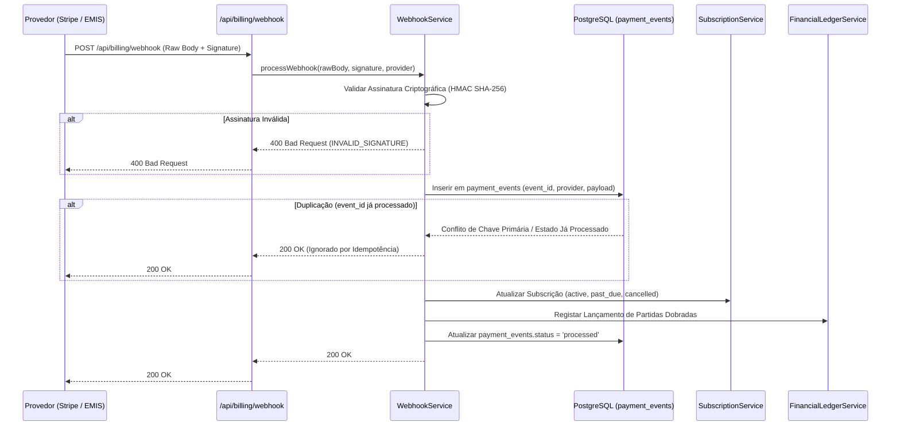

# Processamento Seguro e Idempotente de Webhooks (Fase 6)

## 1. Visão Geral

O processamento de webhooks de pagamento (`src/modules/billing/webhook-service.ts`) constitui a espinha dorsal da sincronização assíncrona entre os provedores externos de pagamento (Stripe, Multicaixa/EMIS, Mock) e o estado das subscrições no **MEETWISE AI**.

---

## 2. Pipeline de Processamento



---

## 3. Garantias de Segurança e Integridade

### A. Validação Criptográfica de Assinatura com Raw Body
Os endpoints nunca analisam o JSON previamente via middleware padrão que altere o espaçamento de caracteres. O corpo binário bruto (*raw buffer*) é preservado para a verificação HMAC:
- **Stripe:** Cabeçalho `stripe-signature` verificado com `STRIPE_WEBHOOK_SECRET` e tolerância a atrasos temporais (*timestamp drift* máximo de 300 segundos para prevenir ataques de repetição).
- **Multicaixa Proxy:** Assinatura HMAC-SHA256 comparada em tempo constante (`crypto.timingSafeEqual`) contra `MULTICAIXA_WEBHOOK_SECRET`.

### B. Idempotência e Tabela `payment_events`
Cada evento recebido possui um identificador único (`event_id` ou `provider_event_id`).
```sql
CREATE TABLE public.payment_events (
    id UUID PRIMARY KEY DEFAULT gen_random_uuid(),
    provider VARCHAR(50) NOT NULL,
    provider_event_id VARCHAR(255) NOT NULL,
    event_type VARCHAR(100) NOT NULL,
    payload JSONB NOT NULL,
    status VARCHAR(50) NOT NULL DEFAULT 'pending',
    error_message TEXT,
    created_at TIMESTAMPTZ NOT NULL DEFAULT now(),
    processed_at TIMESTAMPTZ,
    UNIQUE (provider, provider_event_id)
);
```
Se o mesmo `provider_event_id` for entregue repetidamente pela rede do gateway, o serviço detecta a duplicação, regista um log de idempotência e retorna imediatamente `200 OK` sem reexecutar cobranças, reemitir quotas ou duplicar lançamentos no livro-razão.

### C. Imutabilidade e Anti-Adulteração
A tabela `payment_events` possui um gatilho de base de dados que proíbe operações `DELETE`, garantindo que o histórico de eventos financeiros permaneça auditável para sempre.
